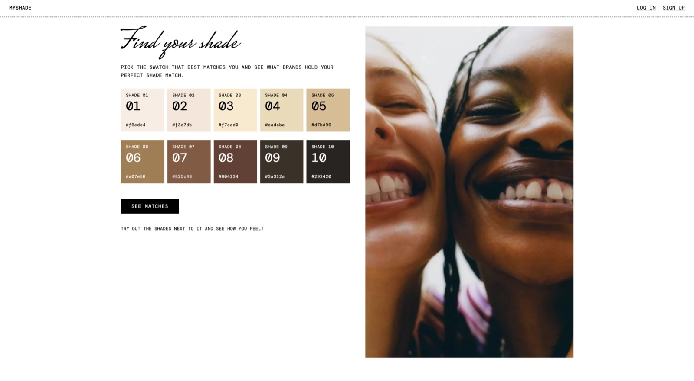

# myShade 🌿

A foundation finder where you pick the skin tone swatch closest to your skin and see which brands have shades matched to it.

## Description

This is a full stack app I built to practice CRUD, authentication, and working with a real data set in MongoDB. You pick one of 10 swatches (Shade 01 to Shade 10), and the app shows foundation shades from a reviewed catalog that are matched to that range, grouped by brand, with the exact shade names the brands use and links to their official pages. Anyone can use the finder without an account. A signed-in user can save their swatch, and an admin can review, approve, add, edit, and delete the brands and shades in the catalog. The matches are potential matches based on the catalog, not guaranteed matches, and the swatch for each shade is my estimate.

## Screenshot



## Features

- Pick from 10 swatches (Shade 01 to Shade 10), each shown with its number and hex code
- No account needed to use the finder
- Results are grouped by brand, and a brand counts once even if it has several matching shades
- Keeps each brand's exact shade name, depth wording, and undertone wording, separate from my swatch estimate
- Shows how confident the match is, and a note when the brand's shade list is only partly captured
- Links to the official product page and shade source for every shade, plus a link that opens the exact shade for brands whose site supports it (Fenty, MAC, and Bobbi Brown so far). Other shades say which shade name to pick on the product page.
- Links to the neighboring swatches, in case you're between two
- Sign up, log in, and save your swatch (passwords are hashed with bcryptjs)
- Admin dashboard that counts distinct approved brands for each of the 10 ranges
- Admin review: every shade starts as "needs-review" and only "approved" shades show to the public
- Admin CRUD for brands and shades, with filters by brand, swatch, and review status
- Only admins can open admin pages, and the server checks this every time
- Duplicate protection: the same brand + product line + shade can't be saved twice

## Tech Used

- HTML
- CSS
- JavaScript
- Node.js
- Express
- MongoDB with Mongoose
- EJS
- Passport (passport-local)
- express and connect-mongo

## About the Data

- `shade-matcher-40-brand-roster.csv`: 40 brands, one foundation line each
- `shade-matcher-10-tone-recommendations.csv`: 80 proposed shades, 8 brands for each of the 10 swatches
- `shade-matcher-10-tone-catalog-notes.md`: notes on how the files were made

The importer saves all 40 brands and all 80 shades, but every shade is saved as **needs-review**. Nothing shows to the public until I approve it in the admin pages. That's on purpose, because brands don't publish a conversion to these swatches, so each match is only a proposal I need to check against the brand's official page.

The data has no product images, so there are none on the site for now.

## How to Use

This app needs [Node.js](https://nodejs.org) and a MongoDB database (I used a free MongoDB Atlas cluster).

1. Download or clone the project, then open the folder in your terminal.
2. Install the packages:
   ```
   npm install
   ```
3. Make your own `.env` file by copying `.env.example`, then fill in your own values:
   ```
   MONGODB_URI=your MongoDB connection string
   SESSION_SECRET=any long random phrase
   ```
   The `.env` file is in `.gitignore` so my secrets don't go on GitHub.
4. Load the brands and proposed shades. The first command only shows what would be saved:
   ```
   npm run import:dry
   npm run import
   ```
5. Start the server:
   ```
   npm start
   ```
6. Open your browser and go to `localhost:8080`.
7. To review the catalog, sign up, then make yourself an admin (there is no button on the website for this on purpose). Log out and back in after:
   ```
   node scripts/makeAdmin.js you@example.com
   ```
8. Open **Admin**, then **Review shades**. Check each shade against its official page, then click **Approve** (or **Edit** to change the swatch match).
9. Pick a swatch on the home page to see the approved matches. As an admin you can also click **Admin: include needs-review** on a results page to preview unapproved shades.
10. To stop the server, press Ctrl + C in the terminal.

## How It Works

1. When you pick a swatch, the form sends the number (1 to 10) to the server. The server checks that it really is a whole number from 1 to 10.
2. The server finds the shades that are **approved** and have a swatch match for that number, from brands that are active.
3. It groups them by brand, counts each brand once, and shows the brand cards with EJS.
4. Each shade has a list of swatch matches (a shade can match neighboring ranges), and each match keeps its confidence and the reason for it.
5. Admin pages use normal forms that POST to the server. Before anything runs, the server checks that you are signed in and have the admin role.

The routes:

| Who | Action | Method | Route |
|---|---|---|---|
| Everyone | Swatches / results | GET, POST | `/`, `/matches` |
| Everyone | One brand's shades | GET | `/brands/:slug` |
| Everyone | Sign up / log in / log out | GET, POST | `/signup`, `/login`, `/logout` |
| Signed in | Save my swatch | POST | `/profile/tone` |
| Admin | Dashboard | GET | `/admin` |
| Admin | Brands (CRUD) | GET, POST | `/admin/brands...` |
| Admin | Shades: list (Read) | GET | `/admin/foundations` |
| Admin | Shades: add (Create) | GET, POST | `/admin/foundations/new`, `/admin/foundations` |
| Admin | Shades: edit (Update) | GET, POST | `/admin/foundations/:id/edit`, `/admin/foundations/:id` |
| Admin | Shades: approve | POST | `/admin/foundations/:id/status` |
| Admin | Shades: delete | POST | `/admin/foundations/:id/delete` |

## What I Learned

- How to model data with two linked collections and a list of matches inside each shade
- How to count distinct brands instead of counting every shade
- How to keep what a brand says separate from what I estimate
- How to use a review status so only checked data shows to the public
- How to protect admin pages with a role check on the server
- How to import a CSV without overwriting my edits
- How to be honest about what a data set can and can't tell you

VIEW APP HERE: https://myshade.onrender.com

## Author

Maya Rose 🌹
